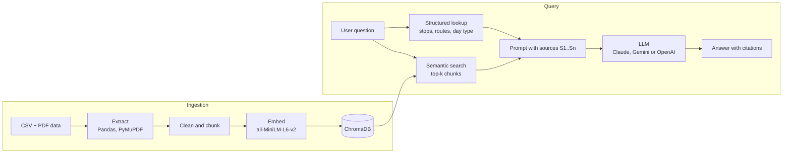

# RoutePilot

**A Retrieval-Augmented Generation (RAG) assistant for public transport.** Ask about routes, timetables, fares and services in plain language and get an answer that cites the documents and data rows it came from.


---

## Contents

- [Features](#features)
- [How it works](#how-it-works)
- [Tech stack](#tech-stack)
- [Getting started](#getting-started)
- [Configuration](#configuration)
- [API reference](#api-reference)
- [Project structure](#project-structure)
- [Dataset](#dataset)
- [Testing](#testing)
- [Team](#team)

## Features

| Feature | Description |
|---|---|
| **Transport assistant** | Chat interface that answers questions using retrieved context only, with `[S1]`-style citations for every claim |
| **Route finder** | Direct and one-change journeys between any two stops, with fares, travel time and next departures |
| **Network map** | Every route and stop on an OpenStreetMap map, with routes drawn along real road paths; click a route or stop to focus it |
| **Timetables** | Departures by route, direction (`Up` / `Down`) and day type (`Weekday`, `Saturday`, `Sunday/Holiday`) |
| **Fares** | Fare between two stops and the full stage fare chart for Ordinary, AC and Night buses |
| **Source citations** | Each answer lists its sources with file name, page or row, and relevance score |
| **Follow-up questions** | Recent chat history is sent with each request, so "and on Sunday?" works after a route question |
| **Offline mode** | Without an LLM API key, the app still answers from exact lookups and the most relevant retrieved sentences |

## How it works



**Ingestion.** CSV files are read row by row with Pandas, and PDF text and tables are extracted with PyMuPDF. The text is cleaned: Unicode is normalised, wrapped lines are re-flowed, and running headers and page numbers are removed. It is then split with LangChain's `RecursiveCharacterTextSplitter` (500 characters, 80 overlap), with one chunk per timetable row. Chunks are embedded with Sentence Transformers and stored in a persistent ChromaDB collection using cosine similarity.

**Hybrid retrieval.** Semantic search handles open questions well, such as *"What concessions do students get?"*, but it is unreliable for exact questions like *"Which bus goes from CIDCO to SGGS Institute, and when is the next one?"*. Each question is therefore also parsed for stop names, route numbers and day type. Stop matching accepts typos and common aliases (for example *"sggs"* or *"bus stand"*). The exact route, timetable and fare facts are added to the prompt as source `[S1]`, ahead of the retrieved document chunks.

**Generation.** The LLM is instructed to answer only from the supplied context and to cite it. The provider is chosen automatically from whichever API key is configured. If no key is set, or the LLM call fails, the app falls back to offline mode and the UI shows a warning.

## Tech stack

| Layer | Technologies |
|---|---|
| Frontend | React 18, Vite, Tailwind CSS, Leaflet (`react-leaflet`) with OpenStreetMap tiles, Lucide icons |
| Backend | Python 3.11, FastAPI, Pydantic |
| RAG | LangChain (core, text splitters, Chroma and HuggingFace integrations) |
| Data processing | Pandas, PyMuPDF |
| Embeddings | Sentence Transformers (`all-MiniLM-L6-v2`) |
| Vector database | ChromaDB (persistent, cosine similarity) |
| LLM providers | Anthropic Claude (official `anthropic` SDK), Google Gemini, OpenAI or any OpenAI-compatible API |
| Testing | pytest, HTTPX |

## Getting started

### Prerequisites

- Python 3.10 or newer
- Node.js 18 or newer

### 1. Backend

```bash
cd backend
python3 -m venv .venv
source .venv/bin/activate

# CPU-only PyTorch keeps the download small
pip install torch --index-url https://download.pytorch.org/whl/cpu
pip install -r requirements.txt

cp .env.example .env          # add an LLM API key (optional, see Configuration)
python -m scripts.ingest      # build the vector index (also runs automatically on first start)
```

### 2. Frontend

```bash
cd frontend
npm install
npm run build
```

### 3. Run

Serve the API and the built UI together on <http://localhost:8000>:

```bash
./run.sh
```

For development with hot reload (UI on <http://localhost:5173>, with `/api` proxied to the backend):

```bash
# terminal 1
cd backend && source .venv/bin/activate && uvicorn app.main:app --reload

# terminal 2
cd frontend && npm run dev
```

Interactive API documentation (Swagger UI) is available at <http://localhost:8000/docs>.

### Example questions

- How do I go from CIDCO to SGGS Institute?
- When is the next bus from Railway Station to the Airport?
- Which bus goes from Vazirabad to the Airport on Sunday? *(needs one change)*
- Route 7N timings on Sunday
- What is the fare from Railway Station to Shivaji Nagar for a senior citizen?
- What concessions do students get? How much is a monthly pass?
- Is Route 4 diverted this month? *(answered from the service notices PDF)*
- Where is the lost and found office?

## Configuration

Settings are read from `backend/.env`. Copy `backend/.env.example` to start. Never commit `.env`; it is already in `.gitignore`.

| Variable | Default | Description |
|---|---|---|
| `LLM_PROVIDER` | `auto` | `auto`, `anthropic`, `gemini`, `openai` or `none`. With `auto`, the first configured key wins, in the order Claude, Gemini, OpenAI |
| `ANTHROPIC_API_KEY` | | Claude API key from <https://platform.claude.com> |
| `ANTHROPIC_MODEL` | `claude-opus-5-5` | Claude model ID |
| `ANTHROPIC_EFFORT` | `medium` | How much Claude reasons before answering: `low`, `medium`, `high`, `xhigh` or `max` |
| `GOOGLE_API_KEY` | | Gemini API key from <https://aistudio.google.com/apikey> |
| `GEMINI_MODEL` | `gemini-flash-latest` | Gemini model ID |
| `OPENAI_API_KEY` | | OpenAI key, or the key for an OpenAI-compatible API |
| `OPENAI_MODEL` | `gpt-4o-mini` | OpenAI model ID |
| `OPENAI_BASE_URL` | | Set this to use an OpenAI-compatible API such as Groq or OpenRouter |
| `EMBEDDING_MODEL` | `sentence-transformers/all-MiniLM-L6-v2` | Sentence Transformers model used for embeddings |
| `TOP_K` | `5` | Number of chunks retrieved per question |
| `CHUNK_SIZE` / `CHUNK_OVERLAP` | `500` / `80` | Text splitter settings |

## API reference

| Method | Endpoint | Description |
|---|---|---|
| `GET` | `/api/health` | Service status, active LLM provider and model, number of indexed chunks |
| `POST` | `/api/chat` | `{"question": "...", "history": [...]}` returns the answer, sources and detected intent, stops and day type |
| `GET` | `/api/stops` | All bus stops |
| `GET` | `/api/routes` | Route summaries |
| `GET` | `/api/map` | Stops with coordinates and landmarks, and each route's stop sequence and road path |
| `GET` | `/api/routes/{route_no}/timetable` | Timetable, filterable by `day_type` and `direction` |
| `GET` | `/api/journeys` | Direct or one-change journeys for `source`, `destination` and `day_type` |
| `GET` | `/api/fares` | Fare options between `source` and `destination` |
| `GET` | `/api/fare-chart` | Stage fare chart |
| `POST` | `/api/ingest` | Re-run the ingestion pipeline after changing `data/raw` |

## Project structure

```
RoutePilot/
├── backend/
│   ├── app/
│   │   ├── main.py                 FastAPI app and REST endpoints; also serves the built frontend
│   │   ├── config.py               Settings loaded from .env
│   │   ├── schemas.py              Request and response models
│   │   ├── services/
│   │   │   └── transport.py        Stop matching, route finder, timetables, fares, map data
│   │   └── rag/
│   │       ├── preprocess.py       Extraction, cleaning and chunking
│   │       ├── vectorstore.py      Embeddings, ChromaDB storage and similarity search
│   │       ├── llm.py              Claude, Gemini and OpenAI clients with error handling
│   │       └── pipeline.py         Retrieval, prompting, generation, citations, offline fallback
│   ├── data/raw/                   routes.csv, stops.csv, fare_chart.csv, route_shapes.json, docs/*.pdf
│   ├── scripts/
│   │   ├── generate_sample_data.py Generates the sample dataset and PDFs
│   │   └── ingest.py               Runs the ingestion pipeline
│   ├── tests/                      pytest suite
│   ├── requirements.txt
│   └── .env.example
├── frontend/
│   └── src/                        React app: Assistant, Route Finder, Network Map, Timetables, Fares
└── run.sh                          Builds the UI if needed and starts the server
```

## Dataset

> **Note:** The included dataset is **synthetic sample data** created for this project. It is not an official timetable.

The sample network uses stop names around Nanded, India, and is generated by `scripts/generate_sample_data.py`:

- **`routes.csv`**: 18 routes × 2 directions × 3 day types (108 timetable rows), including two AC express routes and two night services that run past midnight
- **`stops.csv`**: 54 stops with latitude, longitude, landmark and the routes serving each stop. 47 positions come from OpenStreetMap; the remaining 7 are approximate and are flagged in the file and on the map
- **`route_shapes.json`**: road paths between consecutive stops, from OSRM routing over OpenStreetMap data
- **`fare_chart.csv`**: stage fares by number of stops travelled and bus type
- **`docs/`**: three PDFs covering fare policy and concessions, a passenger guide and service notices

### Using your own data

Add or replace files in `backend/data/raw/`, then run `python -m scripts.ingest` or call `POST /api/ingest`.

- Any PDF, TXT or Markdown file is indexed, and other CSV files are indexed row by row.
- The route finder needs a `routes.csv` with the same columns as the sample.
- The map needs a `stops.csv` with `stop_name`, `latitude` and `longitude` columns. Without it, the other pages still work.

## Testing

```bash
cd backend
source .venv/bin/activate
pytest
```

The suite covers:

- stop matching, including typos and aliases
- the route finder: direct, return direction, one change, and night services after midnight
- map data, fares, PDF table extraction and chunking
- every API endpoint and follow-up questions
- the LLM request format, refusal handling and error messages

The tests use fake LLM clients, so they need no API key and make no network calls.

## Team

Developed as an academic mini-project by:

- Atharva Vilas Karegaonkar
- Aditya Waman Raut
- Nagnath Vishwanath Avhad
- Chandrashekhar Patil
- Amit Shubhkaran Varma
